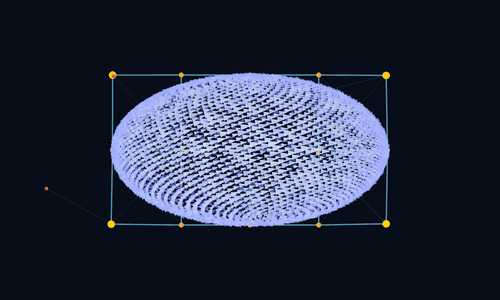

I have been doing some hobby programming in the Odin programming language. Mostly because I wanted to step out of my data engineering bubble and work with a low-level programming language, and I think I am trying to rediscover some of the joy that originally drew me to this profession.

I have sort of landed on building out a flocking simulation engine for birds and fish that tries to mimic [this starling murmuration video on YouTube.](https://www.youtube.com/watch?v=uV54oa0SyMc)

There are a lot of flocking implementations out there, the most foundational of which are boids [(Reynolds, 1987)](https://www.red3d.com/cwr/papers/1987/boids.html). And while boids are great, I found they don't really produce a convincing result for a starling murmuration. Maybe that is all a function of tuning behavior parameters, or maybe I just missed a good demo, but everything I saw was not really what I was going for.

Also, I want to have more control over the shape and behavior of the body of the flock anyway. If I use classic boids, then all individuals run the same algorithm and flocking is an emergent behavior, so you are stuck tuning the individuals' parameters hoping you get a result you like. If this engine ever gets used in a game, the flock's behavior should be directly programable. So, I am looking outside of boids for this project. 

My goals for this engine are:
1. It should look and feel like a murmuration of starlings
2. Be more computationally efficient than vanilla boids at a scale of millions of individuals
3. Have flocking behavior but also split off birds as individuals so they can rejoin or dynamically create new flocks. 
4. Be 2.5d using tricks like parallax and few hard-coded depth layers (I am shooting for 3)

Maybe I will turn this into a modern Asteroids type game? Where the birds shit on you? 

The GIF above is my first pass at using a soft body mesh/skeleton to define the circulation field for the birds. It also uses a 2.5D depth system to give volume to the soft body with birds flying around the primary nodes.

# Tooling needs
Although I only use about 200 lines of Odin code to generate this first simulation, I have already begun yak shaving and building out some developer tools for this project. And in the short term this has actually been much much more fun, and I am learning some cool tricks. 

First, is a GIF exporter in Odin. I want to be generating a lot more of these gifs like the one above and the way I did it for this post was just hell and the result is pretty ugly. So, I am going to look into creating a simple gif recording package in Odin so I can vendor it into the simulation. 

Second, is some telemetry and log file viewing. While this can be handled with `fmt.println()` in Odin, I think I have something better in mind. I am looking at making a TUI to function as a dashboard for logs/errors/telemetry. I would like to be able to monitor the number of draws and physics calculations and compare them to what boids would give me (beating something like `number of birds × nearby-neighbor checks` will be my goal).

